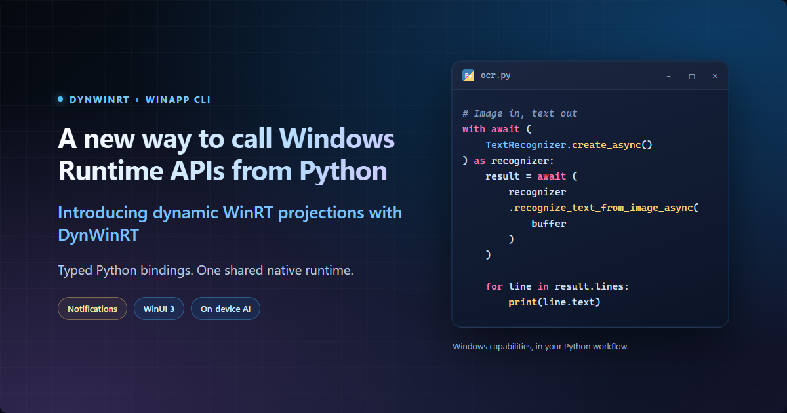
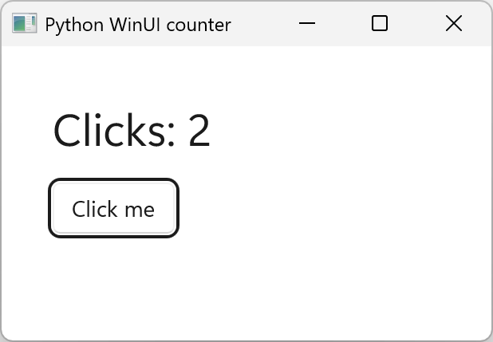
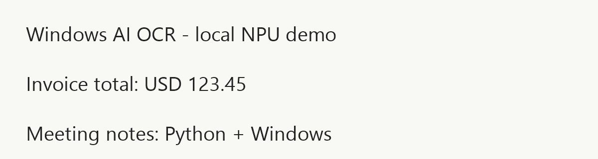

# A new way to call Windows Runtime APIs from Python

*Introducing dynamic WinRT projections with DynWinRT.*



Windows offers native capabilities that can extend a Python application: modern desktop experiences, system integration, and on-device AI. Bringing those capabilities into your application lets you keep Python's familiar workflow while making more of the platform.

**DynWinRT's dynamic projection for Python** connects your code to Windows Runtime (WinRT) APIs. You can use platform features from ordinary Python scripts, build a native desktop interface, and package the result as a Windows application.

## How dynamic projections work

DynWinRT takes a metadata-driven approach. It generates typed Python bindings from Windows Runtime metadata (`.winmd` files), which describes API types and method signatures, while a shared, prebuilt native runtime handles the calls into Windows. For supported APIs, adding a new projection is a Python code-generation step, not another native extension build.

That brings Windows SDK APIs, Windows App SDK features, and your own WinRT components into the same Python workflow. You work with familiar constructors, snake_case members, type hints, and `asyncio`, and regenerate the bindings as your API selection evolves.

## The tools behind the walkthrough

Three packages connect the project setup to the native calls:

- **WinApp CLI's Python package, `winapp-cli`:** provides `winapp-py` for SDK restore, project setup, binding generation, and development identity.
- **[`dynwinrt-codegen`](https://pypi.org/project/dynwinrt-codegen/):** reads `.winmd` files and produces Python modules and type stubs.
- **[`dynwinrt`](https://pypi.org/project/dynwinrt/):** provides the shared runtime that invokes the native Windows methods.

The generated bindings pin the exact runtime version that matches their generator, keeping the Python wrappers and native calls on the same contract.

## Three Windows experiences in Python

Each example is a self-contained Python project: `notification.py` displays a system notification, `counter.py` opens a native window, and `ocr.py` extracts image text that you can copy or process. Notifications and WinUI run without package identity; OCR uses development identity, the local registration that lets Windows recognize the app while testing. The OCR project also includes packaging for distribution as a command-line application.

### Prepare your environment

Use Windows 11 with CPython 3.11-3.14 x64 or ARM64. Install the CLI's Python package:

```powershell
python -m pip install winapp-cli
```

Install the CLI once and make sure `winapp-py` is available in your terminal. Each example below creates its own project with a separate `.venv`, bindings configuration, manifest, SDK pins, and generated package. You can try any example without running the others.

These examples use Windows App SDK 2.5 and need its matching Windows App Runtime installed.

### 1. Show a rich Windows notification

A system notification can keep a Python tool visible while you work elsewhere. This example shows a progress bar fixed at 65% to demonstrate notification content; it is not connected to a running job's progress.

Create and initialize a new notification project:

```powershell
New-Item -ItemType Directory -Path "$HOME\python-notification-demo"
Set-Location "$HOME\python-notification-demo"
winapp-py init . --use-defaults --add-python-bindings
```

Initialization prepares the manifest, assets, SDK version pins in `winapp.yaml`, and project `.venv`. It generates bindings under `.winapp\python\winapp_bindings` and installs them into that environment. The default package name, `winapp_bindings`, matches the imports below. The default scope already includes notification APIs, so `types = []` is enough to start.

Save this as `notification.py` in `python-notification-demo`:

```python
import asyncio
import os
from pathlib import Path
import sysconfig

from dynwinrt import RoApartment, init_winappsdk
from winapp_bindings.microsoft.windows.app_notifications import AppNotificationManager
from winapp_bindings.microsoft.windows.app_notifications.builder import (
    AppNotificationBuilder,
    AppNotificationProgressBar,
)


TAG = "python-projection-demo"


async def show_notification() -> None:
    with RoApartment():
        if not AppNotificationManager.is_supported():
            raise RuntimeError("Windows app notifications are not supported")

        progress = (
            AppNotificationProgressBar()
            .set_title("Processing images")
            .set_status("Running locally")
            .set_value(0.65)
            .set_value_string_override("65%")
        )
        notification = (
            AppNotificationBuilder()
            .add_text("Python task in progress")
            .add_text("This is a native Windows progress notification.")
            .add_progress_bar(progress)
            .set_tag(TAG)
            .build_notification()
        )

        manager = AppNotificationManager.get_default()
        manager.register()
        try:
            manager.show(notification)
            if notification.id == 0:
                raise RuntimeError("Windows did not assign a notification ID")
            print(f"Notification {notification.id}: native progress bar at 65%")
            await asyncio.sleep(5)
        finally:
            try:
                await manager.remove_by_tag_async(TAG)
            finally:
                manager.unregister()


def main() -> None:
    architecture = {
        "win-arm64": "arm64",
        "win-amd64": "x64",
    }.get(sysconfig.get_platform())
    if architecture is None:
        raise RuntimeError("Use Windows x64 or ARM64 CPython")
    bootstrap = (
        Path(__file__).resolve().parent
        / ".winapp"
        / "bin"
        / architecture
        / "Microsoft.WindowsAppRuntime.Bootstrap.dll"
    )
    if not bootstrap.is_file():
        raise FileNotFoundError(f"Run winapp-py restore; missing {bootstrap}")
    os.environ["WINAPPSDK_BOOTSTRAP_DLL_PATH"] = str(bootstrap)
    runtime = init_winappsdk(2, 5)
    try:
        asyncio.run(show_notification())
    finally:
        del runtime


if __name__ == "__main__":
    main()
```

Save the script in the project folder, repeat initialization, and run it:

```powershell
winapp-py init . --use-defaults --add-python-bindings
winapp-py run .\notification.py
```

`register()` lets Windows App SDK register the Python executable as a notification source with its default name and icon. This is notification registration, not package identity. The script prints the assigned notification ID, waits five seconds, removes its notification, and releases the process's active registration. Source information remains available for later runs.

Use a non-elevated terminal. Notification settings and Do Not Disturb can affect banner visibility. The example is display-only; responding to a click or launching the app from a notification is a separate integration described in the [notification quickstart](https://learn.microsoft.com/en-us/windows/apps/develop/notifications/app-notifications/app-notifications-quickstart).

### 2. A small native window with WinUI 3

This project creates an application window. WinUI 3 is Windows' native desktop UI framework; its experimental Python projection lets this counter create controls and handle button events without a C# host. It runs without an NPU or package identity.

Create and initialize a separate counter project:

```powershell
New-Item -ItemType Directory -Path "$HOME\python-winui-counter"
Set-Location "$HOME\python-winui-counter"
winapp-py init . --use-defaults --add-python-bindings
```

WinUI controls are opt-in rather than default generation roots. In this project's generated `pyproject.toml`, replace `types = []` in `[tool.winapp.python-bindings]` with these six types:

```toml
types = [
    "Microsoft.UI.Xaml.Application",
    "Microsoft.UI.Xaml.Window",
    "Microsoft.UI.Xaml.Controls.Button",
    "Microsoft.UI.Xaml.Controls.StackPanel",
    "Microsoft.UI.Xaml.Controls.TextBlock",
    "Microsoft.UI.Xaml.Automation.AutomationProperties",
]
```

Save this complete program as `counter.py` in `python-winui-counter`:

```python
from collections.abc import Callable
import os
from pathlib import Path
import sysconfig

from dynwinrt import (
    RO_INIT_SINGLETHREADED,
    RoApartment,
    init_winappsdk,
    to_winrt_object,
)
from winapp_bindings.microsoft.ui.xaml import Application, Thickness, Window
from winapp_bindings.microsoft.ui.xaml.automation import AutomationProperties
from winapp_bindings.microsoft.ui.xaml.controls import Button, StackPanel, TextBlock
from winapp_bindings.windows.graphics import SizeInt32


def run_window() -> None:
    application: Application | None = None
    window: Window | None = None
    subscriptions: list[Callable[[], None]] = []

    with RoApartment(RO_INIT_SINGLETHREADED):

        def launched() -> None:
            nonlocal window
            count = 0
            label = TextBlock()
            label.text = "Clicks: 0"
            label.font_size = 28
            AutomationProperties.set_automation_id(label, "Count")

            button = Button()
            button.content = to_winrt_object("Click me")
            AutomationProperties.set_automation_id(button, "Increment")

            def clicked(_sender: object, _args: object) -> None:
                nonlocal count
                count += 1
                label.text = f"Clicks: {count}"
                print(label.text, flush=True)

            def closed(_sender: object, _args: object) -> None:
                if application is not None:
                    application.exit()

            panel = StackPanel()
            panel.spacing = 16
            panel.margin = Thickness(32, 32, 32, 32)
            panel.children.extend([label, button])

            window = Window()
            window.title = "Python WinUI counter"
            window.content = panel
            window.app_window.resize(SizeInt32(640, 440))
            subscriptions.append(button.subscribe_click(clicked))
            subscriptions.append(window.subscribe_closed(closed))
            window.activate()
            print("Python WinUI counter ready", flush=True)

        def initialize(_params: object) -> None:
            nonlocal application
            application = Application.create(launched)

        try:
            Application.start(initialize)
        finally:
            for unsubscribe in reversed(subscriptions):
                unsubscribe()
            window = None
            application = None


def main() -> None:
    architecture = {
        "win-arm64": "arm64",
        "win-amd64": "x64",
    }.get(sysconfig.get_platform())
    if architecture is None:
        raise RuntimeError("Use Windows x64 or ARM64 CPython")
    bootstrap = (
        Path(__file__).resolve().parent
        / ".winapp"
        / "bin"
        / architecture
        / "Microsoft.WindowsAppRuntime.Bootstrap.dll"
    )
    if not bootstrap.is_file():
        raise FileNotFoundError(f"Run winapp-py restore; missing {bootstrap}")
    os.environ["WINAPPSDK_BOOTSTRAP_DLL_PATH"] = str(bootstrap)
    runtime = init_winappsdk(2, 5)
    try:
        run_window()
    finally:
        del runtime


if __name__ == "__main__":
    main()
```

The button event increments a Python integer and updates the `TextBlock`. WinUI runs in the single-threaded WinRT apartment selected by `RO_INIT_SINGLETHREADED`. Closing the window ends the application loop; the `finally` block removes event subscriptions before the apartment closes.

Save `counter.py`, update `types`, then initialize and run:

```powershell
winapp-py init . --use-defaults --add-python-bindings
winapp-py run .\counter.py
```

Click **Click me** to increment the label, then close the window. The screenshot shows `Clicks: 2` after two button invocations. WinUI hosting remains experimental, so this is a focused window-and-events example rather than a complete GUI framework integration.



### 3. Recognize image text locally with the NPU

OCR turns text in an image into text you can copy or process. This project uses [Windows AI Text Recognition](https://learn.microsoft.com/en-us/windows/ai/apis/text-recognition) on the NPU (neural processing unit). The script calls `Microsoft.Windows.AI.Imaging.TextRecognizer` and prints the recognized lines in their original language.

OCR requires a supported Copilot+ PC, a ready text recognition model, and Developer Mode for development identity. Create and initialize its own project:

```powershell
New-Item -ItemType Directory -Path "$HOME\python-npu-ocr"
Set-Location "$HOME\python-npu-ocr"
winapp-py init . --use-defaults --add-python-bindings
```

In the OCR project's generated `pyproject.toml`, replace `types = []` in `[tool.winapp.python-bindings]` with these three image and stream types:

```toml
types = [
    "Windows.Graphics.Imaging.BitmapDecoder",
    "Windows.Storage.Streams.InMemoryRandomAccessStream",
    "Windows.Storage.Streams.DataWriter",
]
```

These classes supply image decoding and stream access. `TextRecognizer` and `ImageBuffer` already belong to the default scope, so keep the generated `package = "winapp_bindings"` and `scope = "default"` settings.

The program decodes a file into a BGRA8 `SoftwareBitmap`, wraps it in an `ImageBuffer`, and awaits recognition. Save it as `ocr.py` in `python-npu-ocr`:

```python
import argparse
import asyncio
from pathlib import Path

from dynwinrt import RoApartment, has_package_identity
from winapp_bindings.microsoft.graphics.imaging import ImageBuffer
from winapp_bindings.microsoft.windows.ai import AIFeatureReadyState
from winapp_bindings.microsoft.windows.ai.imaging import TextRecognizer
from winapp_bindings.windows.graphics.imaging import (
    BitmapAlphaMode,
    BitmapDecoder,
    BitmapPixelFormat,
)
from winapp_bindings.windows.storage.streams import DataWriter, InMemoryRandomAccessStream


async def recognize(path: Path) -> str:
    if not has_package_identity():
        raise RuntimeError("Run this example with winapp-py run --identity")
    image = await asyncio.to_thread(path.read_bytes)
    with RoApartment():
        state = TextRecognizer.get_ready_state()
        if state != AIFeatureReadyState.Ready:
            raise RuntimeError(f"Windows AI OCR model is not ready: {state.name}")

        with InMemoryRandomAccessStream() as stream:
            with DataWriter(stream) as writer:
                writer.write_bytes(image)
                await writer.store_async()
                writer.detach_stream()
            stream.seek(0)

            decoder = await BitmapDecoder.create_async(stream)
            bitmap = await decoder.get_software_bitmap_async(
                BitmapPixelFormat.Bgra8, BitmapAlphaMode.Ignore
            )
            with bitmap, ImageBuffer.create_for_software_bitmap(bitmap) as buffer:
                with await TextRecognizer.create_async() as recognizer:
                    result = await recognizer.recognize_text_from_image_async(buffer)

                    lines: list[str] = []
                    for line in result.lines:
                        if line is None:
                            raise RuntimeError("Windows AI OCR returned a null line")
                        lines.append(line.text)
                    return "\n".join(lines)


def main() -> None:
    parser = argparse.ArgumentParser(description="Recognize image text with Windows AI")
    parser.add_argument("image", type=Path)
    args = parser.parse_args()
    print(asyncio.run(recognize(args.image)))


if __name__ == "__main__":
    main()
```

Save `ocr.py`, update `types`, and initialize again to generate the added bindings:

```powershell
winapp-py init . --use-defaults --add-python-bindings
```

Once initialization finishes, edit the OCR project's `Package.appxmanifest` to declare the Windows AI capability. Add this namespace attribute to the existing `<Package>` opening tag and append `systemai` to its `IgnorableNamespaces` tokens:

```xml
xmlns:systemai="http://schemas.microsoft.com/appx/manifest/systemai/windows10"
```

Inside the existing `<Capabilities>`, add:

```xml
<systemai:Capability Name="systemAIModels" />
```

Update the existing desktop `TargetDeviceFamily`'s `MaxVersionTested` as well:

```xml
<TargetDeviceFamily Name="Windows.Desktop" MinVersion="10.0.18362.0" MaxVersionTested="10.0.28000.0" />
```

Keep the minimum version appropriate to your project; the value above comes from the generated manifest. [Windows AI setup guidance](https://learn.microsoft.com/en-us/windows/ai/apis/get-started) requires `MaxVersionTested` of `10.0.26226.0` or later; the example sets it to `10.0.28000.0`. Keep the remaining manifest entries. The development identity is derived from this edited manifest, so it carries the AI capability.

Save the [provided test image](assets/python-npu-ocr-input-english.png) as `sample.png` in `python-npu-ocr`, or use your own image path. Run the script with development identity:



```powershell
winapp-py run --identity .\ocr.py -- .\sample.png
```

Recognized text excerpt:

```text
Windows AI OCR - local NPU demo
Invoice total: USD 123.45
Meeting notes: Python + Windows
```

The script prints the extracted lines as plain text, so you can copy them into another application or pass them to your own processing code. The excerpt above contains the three English lines from the recorded recognition result.

The readiness check reports unavailable models, missing capabilities, and unsupported devices before recognition. The `systemAIModels` declaration and model readiness are separate requirements; declaring the capability does not prepare a model. If components need preparation, ask the device's user before calling `ensure_ready_async()` and check its result. The example stays on Windows AI Text Recognition rather than falling back to the older `Windows.Media.Ocr` engine.

The command-line entry point uses `asyncio.run`; in an application that already has an event loop, call `await recognize(path)` to get the text. The sample reads the whole image into memory and suits small inputs. Use a Unicode-capable terminal when displaying non-ASCII text, and check important extracted values before relying on them.

#### Package and share the OCR app

When you're ready to share your OCR tool, you can package it as an installable Windows app. PyInstaller bundles the Python interpreter, `ocr.py`, DynWinRT, and the generated bindings. WinApp CLI then turns that application directory into an MSIX package for installation on Windows.

Run the following commands from `python-npu-ocr`, keeping the Windows AI capability and matching Windows App Runtime dependency in that project's `Package.appxmanifest`.

**1. Bundle Python, DynWinRT, and the generated bindings.**

```powershell
python -m pip --python .\.venv\Scripts\python.exe install PyInstaller
.\.venv\Scripts\python.exe -I -B -m PyInstaller `
    --clean --noconfirm --onedir --name PythonOcr `
    --paths .\.winapp\python `
    --collect-all dynwinrt --collect-submodules winapp_bindings `
    .\ocr.py
```

**2. Add a command-line alias and create a signed development package.**

```powershell
winapp-py manifest add-alias --name python-ocr-demo.exe --manifest .\Package.appxmanifest
winapp-py cert generate --manifest .\Package.appxmanifest --output .\devcert.pfx
winapp-py package .\dist\PythonOcr --manifest .\Package.appxmanifest `
    --executable PythonOcr.exe --cert .\devcert.pfx --output .\dist\PythonOcr.msix
```

**3. Trust the development certificate from Administrator PowerShell.**

```powershell
winapp-py cert install .\devcert.pfx
```

**4. Return to normal PowerShell, install, and run the packaged app.**

```powershell
Add-AppxPackage .\dist\PythonOcr.msix
python-ocr-demo.exe (Resolve-Path .\sample.png).Path
```

The installed alias launches the app with Windows package identity. Starting the EXE directly under `dist` does not provide that identity, so it is not the way to run this OCR program. Python is bundled, but the target PC still needs the matching Windows App Runtime and a supported NPU with a ready model.

This is a development-signed MSIX for local testing, distinct from the earlier development-identity runner. For distribution, use release signing, include bundled dependencies' license notices, and validate the final package on target devices. Keep the development PFX private and out of source control.

## Add another API when you need it

Within any of these projects, `types` can select other compatible entry-point classes. After changing that project's selection, regenerate its bindings:

```powershell
winapp-py generate
```

For your own WinRT component, put its metadata in the project and update `additional-winmds` and `additional-refs` in the existing bindings table. This example describes a component you supply; it is not included in the walkthrough:

```toml
additional-winmds = [
    { winmd-path = 'metadata\Vendor.winmd', namespace = "Vendor.Component", classes = ["Thing"] },
]
additional-refs = ['metadata\Dependency.winmd']
```

These additional paths must point to existing `.winmd` files inside the project. Restored SDK files can stay in their NuGet cache. References supply type information without selecting another generation root, although dependent types may still be emitted. Regenerate after updating the metadata inputs; deploying the component's binaries, activation, and capabilities remains part of your application's setup.

## Keep the project reproducible

The CLI is installed once; application dependencies and bindings stay in each project's `.venv`. `winapp-py run` selects that environment. Use it as your editor's interpreter, and add `.winapp\python` to the type checker's search path if needed. Keep application source outside generated directories.

SDK versions are pinned in `winapp.yaml`. Binding workflows select the latest available generator, including prereleases, and install its matching runtime. Record the SDK and generator/runtime versions you use when you need reproducible builds; upgrading the generated package can select a newer pair.

For OCR development, `run --identity` prepares a separate private Python environment and development package without changing the global interpreter. It installs the declared application dependencies and generated bindings there, rather than copying arbitrary packages manually added to `.venv`. Declare dependencies in `pyproject.toml` or the supported requirements file.

When finished testing the OCR project's development identity, run this from `python-npu-ocr` to remove its registration:

```powershell
winapp-py identity clear
```

This preserves the ordinary environment and generated bindings. Ordinary `run` uses an existing `.venv`; it does not create one or initialize Windows App SDK on the script's behalf. The [Python workflow guide](https://github.com/microsoft/winappCli/blob/main/docs/guides/python.md) covers those hosting details.

## Take the next step

These independent projects show three ways to use Windows from Python: system integration, window events, and on-device AI data. Choose the one that fits your application. The optional package gives the OCR tool its own installation and identity while preserving Python as the application language.

Start with the capability your users need, select its APIs, and keep the application logic in Python. Explore the [Python samples](https://github.com/microsoft/dynwinrt/tree/main/samples/python) for more ideas, and share what you build through the repositories below.

### WinApp CLI

- [Repository and feedback](https://github.com/microsoft/winappCli)
- [Python workflow guide](https://github.com/microsoft/winappCli/blob/main/docs/guides/python.md)

### DynWinRT, the projection itself

- [Repository and feedback](https://github.com/microsoft/dynwinrt)
- [Python runtime guide](https://github.com/microsoft/dynwinrt/blob/main/bindings/py/README.md)
- [Python codegen guide](https://github.com/microsoft/dynwinrt/blob/main/tools/dynwinrt-codegen/python/README.md)
- [Runnable examples for this article](samples/python-projections-blog/README.md)
